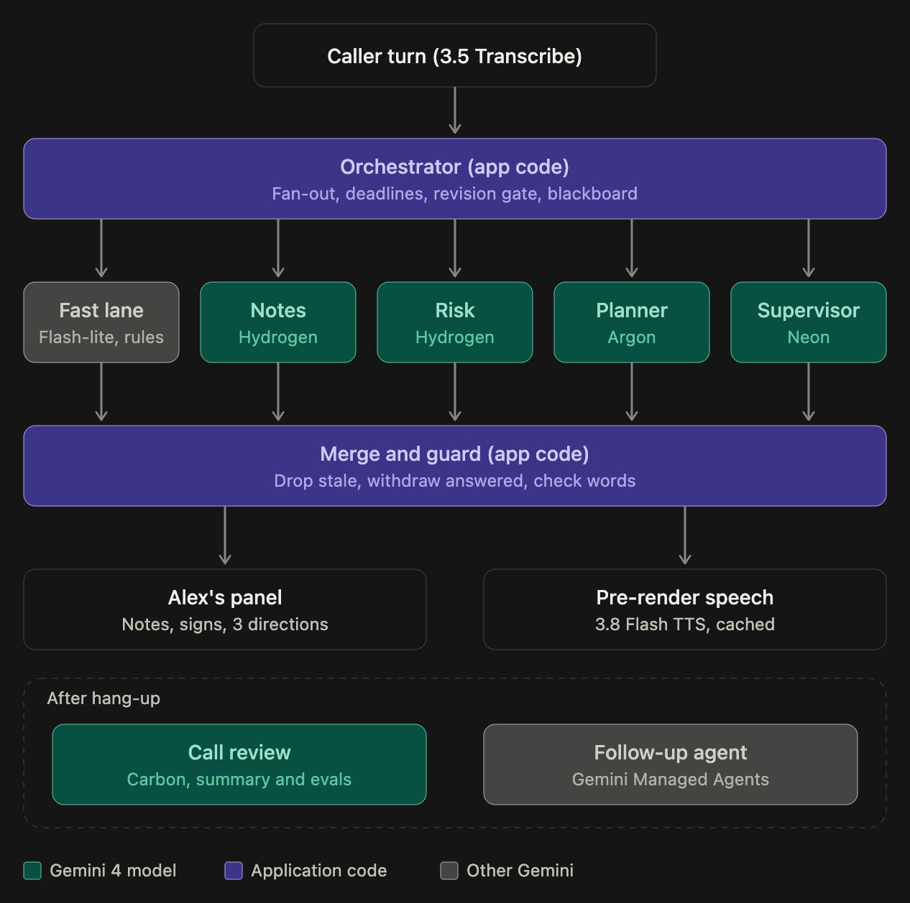

# Uno ReVoice

When a call comes in, Alex can hand it to a clearly identified AI assistant, steer its next line in private, and take the call back in one tap. Several Gemini models listen in parallel: they flag scam warning signs, keep notes, and suggest the next line. App code makes every decision that matters. Gemini 4 NYC Hackathon.

## Architecture



Each finished caller line is sent to every lane at once. The app merges the results.

| Box | Lane | Model (env) | Typical latency | Job |
|---|---|---|---|---|
| Caller turn | transcribe | `gemini-3.5-transcribe-live` (`TRANSCRIBE_MODEL`) | final line ~1 s after the caller stops | One Live session per phone track, so speakers are known without diarization. Interim words stream as captions. |
| Fast lane | rules + flash | regex + `gemini-3.5-flash-lite` (`FLASH_MODEL`) | 1 ms / ~1.3 s | Instant signs and stock directions, then tailored directions in about a second. |
| Risk | risk | `gemini-4-hydrogen` (`RISK_MODEL`) | ~3 s | Provisional warning signs on the newest line. |
| Notes | notes | `gemini-4-hydrogen` (`NOTES_MODEL`) | ~4–5 s | Facts with corrections ("$230, was $280"), each citing its turn, plus the open decision. |
| Planner | planner | `gemini-4-argon` (`PLANNER_MODEL`) | ~7–15 s | The next 3 directions with the exact words. Dropped if a newer caller line arrived first. |
| Supervisor | supervisor | `gemini-4-neon` (`SUPERVISOR_MODEL`) | ~6–8 s | Reads the whole call: confirms or removes signs, vetoes unsafe or pointless directions. |
| Merge and guard | app code | `server/src/brain/orchestrator.ts`, `catalog.ts` | – | Drops stale results, withdraws answered directions, scores risk with fixed weights, locks "High risk: confirmed", blocks unsafe words. |
| Alex's panel | app | `/desk` today, phone app next | – | Notes, signs, 3 directions, take over / take back. |
| Pre-render speech | tts | `gemini-3.8-flash-tts` (`TTS_MODEL`) | cached | Every suggested line is rendered as it arrives, so a tap starts speaking in ~10 ms. |
| Call review | review | `gemini-4-carbon` (`REVIEW_MODEL`) | ~5 s after hang-up | Summary, verdict, follow-up drafts. Evals are computed in code. |
| Follow-up agent | followup | `gemini-4-neon` (`FOLLOWUP_MODEL`) | ~3–6 s after review | `@google/genai` function calling turns review suggestions into up to 4 guarded action proposals Alex approves one by one. |

How the directions board fills in on each caller line:

1. **~1 ms:** stock cards from the rules. Their speech is pre-rendered when the call starts.
2. **~1.3 s:** tailored cards from Flash-Lite.
3. **~7–15 s:** Argon's cards, if no newer caller line arrived first.

Even when Argon is late, it writes a one-sentence **strategy** that the next Flash-Lite pass follows. For example: "caller dodged the family check; push the callback, then decline". The slow model always contributes something.

While the agent has the floor, tailored cards for the same caller line are not swapped under Alex's finger. The upgrade is held until Alex takes back.

We benchmarked Hydrogen as the fast lane, to keep the live path all Gemini 4. With thinking low it took 4.1–5.0 s against Flash-Lite's ~1.3 s, and with thinking off most calls timed out. So Flash-Lite stays; `FLASH_MODEL` flips it.

Lanes that are slower than one caller line run one at a time, and a newer line queues a single rerun, so they never pile up. A lane that fails or times out adds nothing that turn; the call keeps going.

### Rules the code enforces (models only propose)

- **Score:** fixed weights per sign (money +3, code +4, failed family check +3, refused callback +3, third-party payment +2, ...; passing the family check −5). Low 0–3, Medium 4–7, High 8+.
- **Lock:** "High risk: confirmed" needs a supervisor-confirmed High score, a failed family check or refused callback, and a money or code request. Once locked, it stays locked.
- **Guard on everything the agent says:** no codes or 4–8 digit numbers, no approvals or payment promises, no notes, scores or "scam" talk, no speaking as Alex or family, never ends the call.
- **Floor:** every tap carries an action ID and a revision. Duplicates and stale taps are rejected. Take back and End always work. One question at a time.

### Follow-up agent

After hang-up and Carbon's review, `server/src/brain/followup.ts` (`proposeFollowUps`, `FOLLOWUP_MODEL`, default `gemini-4-neon`) turns the review's suggested next steps into up to 4 concrete proposals using **`@google/genai` function calling** (`generateContent` with `functionDeclarations`). We chose `@google/genai` function calling rather than Gemini Managed Agents (the Interactions API / `antigravity-preview-09-2026` remote Linux sandbox), which requires `@google/genai` v2.3+ and is designed for autonomous remote sandbox execution rather than low-latency, locally guarded human-in-the-loop proposals.

- **Proposal-only tools:** `draft_text_message` (to a saved contact), `draft_report` (`bank` | `ftc` | `police` | `other`), `block_number`, and `set_reminder`. There are no tools to send money, share codes, or call a scammer back.
- **Guard:** every draft body and reminder text is checked for 4–8 digit codes, payment promises, and callbacks to a scammer's number; failures are dropped before reaching Alex.
- **Approval required:** `followup.proposed` lists the actions; nothing executes until Alex sends `followup.approve` (or `followup.dismiss`) over the socket, even after the call has ended. Each `followupId` runs at most once: `block_number` adds the number to the in-memory blocklist (`server/src/blocklist.ts`), `set_reminder` saves it in memory, and `draft_*` returns the final text as ready to send.

## Run it

```bash
cp .env.example .env   # add GEMINI_API_KEY
npm install
npm run dev
```

- **Brain test desk:** `http://localhost:5173/desk`. Scripted calls stand in for the phone. Each scripted line goes through every lane. You can type live lines, take over, tap a direction (the agent speaks), press Esc to cut it off, then end the call to see the Carbon review.
- **Server:** `http://localhost:8787`

### Headless runs and evals

```bash
npm test                                                  # unit tests: guard, rules, scoring/lock, audio, retry
cd server
npx tsx --env-file=../.env scripts/replay.ts maya        # one call, full event log + review
npx tsx --env-file=../.env scripts/replay.ts all         # all 8 scenarios in parallel, eval table
npx tsx --env-file=../.env scripts/replay.ts live all    # fully automatic: Gemini plays the caller, the agent auto-speaks
npx tsx --env-file=../.env scripts/sim-twilio.ts maya    # fake Twilio call against the running server
```

Latest runs (8 evals per call, incl. tone): `replay.ts all` **64/64**, `replay.ts live` **64/64** across all 8 scenarios (the live caller improvises, so live runs can vary).

**Live demo with your voice (desk → "Caller: me, on the mic").** Pick a scenario (it sets the caller ID: unknown number, contact, etc.), choose *Caller: me, on the mic*, press **Start call** and allow the mic. Talk as the scammer, the family member or anyone. Gemini Live transcribes you with captions as you speak, and every line runs through the full brain. Tap **Agent take over** whenever you like: the agent answers you out loud, either the card you tap or its most confident card about 1 s after your line lands (`MIC_AUTO_SPEAK_MS`, end-of-speech pause `STT_SILENCE_MS`=400). Talk over it to cut it off; **Take back** (Esc) returns the floor. Headphones are best; with speakers, browser echo cancellation plus a server echo filter keep the agent's own voice out of your transcript. `npx tsx --env-file=../.env scripts/sim-mic.ts maya` runs the same path headless with synthetic speech.

**Live caller and auto-speak.** The desk defaults to *Live caller*: Gemini 3.5 Flash-Lite (`CALLER_MODEL`, ~0.5 s a reply) plays the scenario's persona from `server/src/scenarios.ts` and answers whatever the agent or Alex says. It sees only the spoken transcript. Once Alex hands over, the agent says its highest-confidence direction on its own if Alex doesn't tap within `AUTO_SPEAK_MS` (default 4000). Flash-Lite cards land at ~1.3 s (p90 ~2.4 s) and their speech is pre-rendered by ~3-4 s, which still leaves Alex 2-3 s to override. If only stock cards are up, it waits up to 4 s more for a tailored one. Near-repeats of earlier agent lines are dropped (a genuine repeat becomes "Like I said, ..."), and the post-call review scores the agent's tone (Carbon 1-5 plus code checks for accusing, shouting and repeated lines). The agent voice is Sulafat, the calmest and warmest in `server/scripts/check-tone.ts`, which has Gemini listen to each candidate voice and score it (TTS style prompts get read aloud, so tone comes from the voice). Every direction carries a `confidence` (0-1). The app gets `agent.autoPick {directionId, inMs}` for a countdown, and `agent.say` carries `auto: true` when nobody tapped.
- Correct risk level and verdict on all 8 calls.
- Every scam that failed a check locked as "High risk: confirmed".
- No legitimate call was flagged.
- Each caller line got tailored directions before the next line.
- The agent spoke no codes and no private analysis.

`sim-twilio.ts` streams the scenario as real 8 kHz µ-law phone audio into `/twilio`. It joins as Alex's app, takes over, picks a direction, takes back mid-sentence and hangs up, so it exercises the whole phone path without a Twilio account.

## Phone (Twilio)

1. Expose the server, e.g. `ngrok http 8787`, and set `PUBLIC_HOST` to the ngrok host.
2. Point the Twilio number's voice webhook to `POST https://<PUBLIC_HOST>/twilio/voice`. It returns TwiML that `<Connect><Stream>`s the call to `wss://<PUBLIC_HOST>/twilio`.
3. What the server does on that stream:
   - **Inbound track:** transcribed as the caller.
   - **Outbound track, if streamed:** transcribed as Alex.
   - **Agent lines:** sent back into the call as µ-law audio, followed by a `mark`.
   - **Take back:** sends `clear`, which stops playback at once.
4. Alex's app joins the live call over WebSocket.

### Twilio security

Set `TWILIO_AUTH_TOKEN` to enforce request verification:
- `POST /twilio/voice` verifies `X-Twilio-Signature` (`HMAC-SHA1` over `https://<PUBLIC_HOST|Host><req.url>` + sorted POST params) and returns `403` on mismatch.
- The returned TwiML embeds `<Parameter name="sig"/>` (`HMAC-SHA256` of `CallSid`), which `/twilio` verifies on the stream `start` event before creating a `LiveCall`.
- If `TWILIO_AUTH_TOKEN` is unset, requests are allowed for local testing and the server logs `Twilio signature check OFF` at startup. Run `cd server && npx tsx scripts/check-twilio-auth.ts` to self-test against Twilio's worked example.

### Call history

Completed call reviews are saved as JSON to `server/data/calls/<callId>.json` (override the base dir with `DATA_DIR`; set `SAVE_CALLS=0` to disable, as `scripts/replay.ts` does). `GET /api/calls` returns live and saved calls newest-first, and `GET /api/calls/<id>/review` falls back to disk after a call leaves memory.

## API for the phone app

Connect to `ws(s)://<host>/ws` and send `{ "type": "join", "role": "app", "callId": "<CallSid>" | "latest", "token": "<APP_TOKEN>" }`. A missing or wrong token closes the socket with code 4401. With no `APP_TOKEN` set, only the server's own machine may join. HTTP calls under `/api/calls` need `Authorization: Bearer <APP_TOKEN>`. Every event since the call started is replayed, then events stream live. The message types are in `shared/brain.ts`.

**Server → app**
- `turn.final`, `caption.interim`
- `risk.signal`, `risk.level`
- `notes.update`, `decision.open`
- `directions`, `directions.withdrawn`
- `agent.say`, `agent.cut`
- `state`, `lane.result`
- `call.ended`, `call.review`
- `followup.proposed`, `followup.result`

**App → server.** Live-call taps carry `actionId` and `revision`; follow-up approvals work after hang-up.
- `control.delegate`, `control.takeback`
- `direction.pick`, `call.end`
- `desk.say` with speaker `alex`, to type a line
- `followup.approve`, `followup.dismiss`

**HTTP**
- `GET /api/health`
- `POST /api/tts` with `{text, voice}`, returns WAV
- `POST /twilio/voice` (TwiML)
- `GET /api/calls` (live + saved calls, newest first)
- `GET /api/calls/<id>/review` (live or saved)

## Layout

```
shared/brain.ts               event contract (desk, phone app, server)
server/src/call.ts            LiveCall: brain + floor, revision, one-shot taps, agent voice, review + follow-ups on hang-up
server/src/brain/orchestrator.ts  fan-out, merge, stale/answered handling, risk scoring
server/src/brain/lanes.ts     risk, notes, planner/flash, supervisor prompts + output validation
server/src/brain/review.ts    Carbon summary/verdict/follow-ups + code evals
server/src/brain/followup.ts  Neon function-calling follow-up agent + approval executors
server/src/brain/catalog.ts   sign weights, lock rule, stock directions, guard
server/src/brain/rules.ts     regex fast lane
server/src/blocklist.ts       in-memory blocklist populated after Alex approves block_number
server/src/transcribe.ts      Gemini 3.5 Transcribe (Live) per track
server/src/twilio.ts          Twilio Media Streams bridge + TwiML
server/src/twilioAuth.ts      Twilio webhook HMAC-SHA1 and stream HMAC-SHA256 verification
server/src/store.ts           JSON call history persistence and listing
server/src/audio.ts           WAV, resampling, µ-law
server/src/scenarios.ts       8 scripted calls (4 scam, 4 legitimate/everyday)
server/src/desk.ts            desk/app socket sessions
web/src/pages/DeskPage.tsx    test desk UI
```

The earlier two-laptop WebRTC prototype is still in place: `/alex`, `/caller`, `server/src/room.ts`, `web/src/lib/{rtc,mixer}.ts`.
