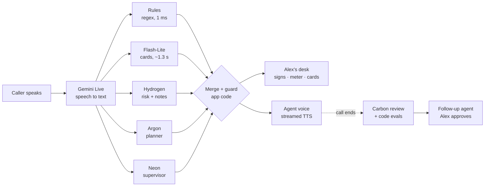

<div align="center">


# Uno ReVoice

**Hand a suspicious call to an AI assistant. It verifies the caller, refuses the money, and gives the call back to you in one tap.**

Built at the **Gemini 4 NYC Hackathon** · 7 Gemini models · code decides, models propose


</div>

---

## Why

Phone scams don't hack computers. They hack people: a panicked voice, a fake emergency, a demand for money *right now*. "Just hang up" fails exactly when the voice sounds like your sister, and AI voice cloning makes that easier every month.

**ReVoice puts AI on your side of the call.** When Alex gets a call that feels off, Alex taps **Agent take over**. ReVoice introduces itself as Alex's AI assistant, asks the questions that expose a scam (a family question only the real person knows, or "Alex will call you back on the saved number"), and politely declines anything risky. Alex listens the whole time, sees what ReVoice is thinking, and can take the call back instantly.

```text
Caller   Hey, it's Maya. My phone broke, I'm calling from a friend's phone.
ReVoice  Hi, this is Alex's AI assistant. Alex is listening in.
ReVoice  Alex asked me to check: what's the name of Alex's dog?
Caller   I was in a car accident. I need $900 for the tow right now.
         ── risk: High ──
ReVoice  I'm glad you're okay. Since you weren't sure, Alex will call Maya on the number Alex has saved.
Caller   No time! Just Venmo it to my friend Jordan.
         ── High risk: confirmed ──
ReVoice  Alex won't send the $900 to Jordan on this call.
```

It never accuses, never says "scam" out loud, never shares a code and never pretends to be Alex.

## Highlights

| | |
|---|---|
| 🧠 **Parallel brain** | Every caller line goes to 5 lanes at once: regex rules, Flash-Lite, Gemini 4 Hydrogen, Argon and Neon. Late results are dropped, so advice is never stale. |
| 🎙️ **Feels like a real call** | Streamed voice (first sound in ~0.7 s), a quick "Mm-hm." ~1.3 s after the caller stops, a full reply in ~3 s, and it never talks over the caller. |
| 🛡️ **Code decides** | Risk score, the "High risk: confirmed" lock and every spoken word are checked by rules no model can override. |
| 🎛️ **Alex stays in control** | Live captions, warning signs with the line that triggered each, suggested replies, one-tap take over and take back (Esc). |
| 📋 **After the call** | Gemini 4 Carbon writes a summary, verdict and tone score. A function-calling agent drafts follow-ups (block the number, report to the bank) that Alex approves one by one. |
| ☎️ **Real phone path** | A Twilio Media Streams bridge feeds the same brain and plays the agent back into the call. |

## How it works

<p align="center"></p>



### The lanes

| Lane | Model (env var) | Latency | Job |
|---|---|---|---|
| Transcribe | `gemini-3.5-transcribe-live` (`TRANSCRIBE_MODEL`) | final ~1 s after speech | One Live session per phone track, so speakers are known without diarization. Interim words stream as captions. |
| Rules + flash | regex + `gemini-3.5-flash-lite` (`FLASH_MODEL`) | 1 ms / ~1.3 s | Instant signs and stock replies, then tailored replies in about a second. |
| Risk | `gemini-4-hydrogen` (`RISK_MODEL`) | ~3 s | Warning signs on the newest line, each citing the line that proves it. |
| Notes | `gemini-4-hydrogen` (`NOTES_MODEL`) | ~4–5 s | Facts with corrections ("$230, was $280") and the open decision. |
| Planner | `gemini-4-argon` (`PLANNER_MODEL`) | ~7–15 s | The next 3 replies with exact words and a confidence score. Dropped if a newer line arrived first. |
| Supervisor | `gemini-4-neon` (`SUPERVISOR_MODEL`) | ~6–8 s | Reads the whole call, confirms or removes signs, vetoes unsafe or pointless replies. |
| Voice | `gemini-3.8-flash-tts` (`TTS_MODEL`) | first audio ~0.7 s | Streamed PCM; suggested lines are pre-rendered so a tap plays at once. Voice: Sulafat. |
| Review | `gemini-4-carbon` (`REVIEW_MODEL`) | ~5 s after hang-up | Summary, verdict, tone score and next steps. Evals are computed in code. |
| Follow-ups | `gemini-4-neon` (`FOLLOWUP_MODEL`) | ~3–6 s after review | Function calling turns next steps into guarded proposals Alex approves. |

**How the suggestions fill in on each caller line:** stock cards in ~1 ms, Flash-Lite's tailored cards at ~1.3 s, Argon's at ~7–15 s. Even when Argon is late, it leaves a one-sentence strategy ("caller dodged the family check; push the callback, then decline") that the next Flash-Lite pass follows, so the slow model always contributes. Cards never swap under Alex's finger while the agent is talking.

> We benchmarked Gemini 4 Hydrogen as the fast lane to keep the live path all Gemini 4. With thinking low it took 4.1–5.0 s against Flash-Lite's ~1.3 s, so Flash-Lite stays. `FLASH_MODEL` flips it.

### Rules the code enforces

- **Risk score.** Fixed weights per sign: money +3, one-time code +4, failed family check +3, refused callback +3, third-party payment +2, passing the family check −5. Low 0–3, Medium 4–7, High 8+.
- **The lock.** "High risk: confirmed" needs all three: a supervisor-confirmed High score, a failed check (family question or refused callback), and a money or code request. Once locked it stays locked.
- **Say-guard.** Every agent line is blocked if it contains a code or 4–8 digit number, asks for card digits, a PIN or a password (unless refusing), approves a payment, mentions notes, scores or "scam", speaks as Alex or family, or ends the call.
- **The floor.** Every tap carries an action ID and a revision, so duplicate and stale taps are rejected. Take back and End always work.

### When the agent talks

- **Take over:** the agent introduces itself as Alex's AI assistant.
- **Auto-speak:** if Alex doesn't tap a card, the agent says its most confident one on its own.
- **No overlap:** it waits until the caller's mic has been quiet for 1 s (mic level, not just captions), so a pause mid-sentence never triggers it. A sentence split by a hesitation is joined back together.
- **Barge-in:** if the caller talks over the agent, the agent stops.
- **Take back:** Esc silences the agent instantly.

## Quick start

```bash
cp .env.example .env      # add your GEMINI_API_KEY
npm install --prefix server && npm install --prefix web
npm run dev:agent         # server on :8787, desk on :5173
```

The repo root is the phone app (see [Phone app](#phone-app)), so `server/` and `web/` install on their own.

Open **http://localhost:5173/desk** in Chrome.

### Demo in 60 seconds

1. Pick **Sister in trouble** and **Caller: me, on the mic**, then press **Start call** and allow the microphone. Headphones are best.
2. Play the scammer: *"Hey, it's Maya. My phone broke, I'm calling from a friend's phone."* Watch the captions, signs and suggested replies appear.
3. Tap **Agent take over**. ReVoice introduces itself and asks a family question.
4. Ask for money: *"I need $900 for the tow right now."* The meter jumps to High.
5. Push: *"Just Venmo it to my friend Jordan."* It locks **High risk: confirmed** and declines.
6. Press **End call** for the review: summary, verdict, tone and follow-ups.

| Caller mode | What it does |
|---|---|
| **Gemini (live)** | Gemini 3.5 Flash-Lite plays the scenario's caller and answers whatever is said. No mic needed. |
| **Me, on the mic** | You play the caller. Gemini Live transcribes you; everything else is identical. |
| **Fixed script** | Press Next line to step through a scripted call. Good for slow, explained walkthroughs. |

## Testing and evals

```bash
npm test                                                   # unit tests: guard, rules, scoring, lock, audio, retry
cd server
npx tsx --env-file=../.env scripts/replay.ts all           # all 8 scenarios, scripted, eval table
npx tsx --env-file=../.env scripts/replay.ts live all      # Gemini plays every caller, agent auto-speaks
npx tsx --env-file=../.env scripts/sim-mic.ts maya         # mic mode end to end with synthetic speech
npx tsx --env-file=../.env scripts/sim-mic.ts maya-pause   # same, with mid-sentence hesitations; counts overlaps
npx tsx --env-file=../.env scripts/sim-twilio.ts maya      # a fake Twilio phone call against the running server
npx tsx --env-file=../.env scripts/check-tone.ts           # Gemini listens to candidate voices and scores them
```

Each call is scored on 8 evals computed in code, not by a model:

- the right risk level and verdict;
- scams that failed a check locked as "High risk: confirmed";
- no legitimate call locked;
- every warning sign cites a real caller line;
- the agent never spoke a code or private analysis;
- tailored replies for each caller line;
- a calm, polite tone (Carbon 1–5 plus code checks for accusing, shouting or repeating).

| Run | Result |
|---|---|
| Scripted replay, 8 scenarios (4 scam, 4 legitimate) | **64/64** |
| Live replay, Gemini as every caller | **64/64** (the live caller improvises, so runs vary) |
| Mic mode, with and without hesitations | **8/8**, **0** overlaps |
| Unit tests | **31/31** |

### Self-improvement (`evals-critic` branch)

After every call, a **Gemini 4 Neon critic** (high thinking) grades classification, questioning, timing and safety. It forms its own verdict without seeing the right answer, and code caps its grades on hard facts. It proposes lessons that go into a versioned playbook the next call reads. Code validates every lesson, replays weight changes on past calls, keeps at most 10 active, and never lets a lesson touch the safety rules.

In one live run, call 2 only offered a callback after a failed check and a $900 ask. The critic wrote *"when a caller fails an identity check and asks for money, decline the payment right away"*, and call 3 scored 100/100. See that branch's README for `npm run eval`, `/evals` and `/reviews`.

## Phone (Twilio)

1. Expose the server (`ngrok http 8787`) and set `PUBLIC_HOST` to that host.
2. Point the Twilio number's voice webhook to `POST https://<PUBLIC_HOST>/twilio/voice`. It returns TwiML that streams the call to `wss://<PUBLIC_HOST>/twilio`.
3. The inbound track is transcribed as the caller and the outbound track as Alex. Agent lines go back as µ-law audio, and take back sends `clear` to stop playback at once.
4. Alex's app joins the live call over WebSocket.

<details>
<summary><b>Twilio security</b></summary>

Set `TWILIO_AUTH_TOKEN` to enforce request verification:

- `POST /twilio/voice` verifies `X-Twilio-Signature` (HMAC-SHA1 over `https://<PUBLIC_HOST|Host><req.url>` plus sorted POST params) and returns `403` on mismatch.
- The TwiML embeds `<Parameter name="sig"/>` (HMAC-SHA256 of `CallSid`), which `/twilio` checks on the stream's `start` event before creating a call.
- Without `TWILIO_AUTH_TOKEN`, requests are allowed for local testing and the server logs `Twilio signature check OFF`. Self-test against Twilio's worked example: `cd server && npx tsx scripts/check-twilio-auth.ts`.

</details>

<details>
<summary><b>Follow-up agent</b></summary>

After the review, `server/src/brain/followup.ts` turns suggested next steps into up to 4 proposals using `@google/genai` function calling. We chose function calling over Gemini Managed Agents because these are low-latency, locally guarded, human-approved proposals, not autonomous sandbox work.

- **Tools (proposal only):** `draft_text_message` (to a saved contact), `draft_report` (bank, FTC, police, other), `block_number`, `set_reminder`. There are no tools to send money, share codes or call a scammer back.
- **Guard:** every draft is checked for codes, payment promises and callbacks to the scammer's number.
- **Approval:** nothing runs until Alex sends `followup.approve`, and each proposal runs at most once.

</details>

<details>
<summary><b>API for the phone app</b></summary>

Connect to `ws(s)://<host>/ws` and send `{ "type": "join", "role": "app", "callId": "<CallSid>" | "latest", "token": "<APP_TOKEN>" }`. A wrong token closes the socket with code 4401; without `APP_TOKEN`, only this machine may join. Every event since the call started is replayed, then events stream live. Types are in `shared/brain.ts`.

**Server → app:** `turn.final`, `caption.interim`, `risk.signal`, `risk.level`, `notes.update`, `decision.open`, `directions`, `directions.withdrawn`, `agent.say`, `agent.ack`, `agent.cut`, `agent.done`, `agent.autoPick`, `state`, `lane.result`, `call.ended`, `call.review`, `followup.proposed`, `followup.result`

**App → server** (live taps carry `actionId` and `revision`): `control.delegate`, `control.takeback`, `direction.pick`, `call.end`, `desk.say`, `followup.approve`, `followup.dismiss`

**HTTP:**

| Route | Returns |
|---|---|
| `GET /api/health` | server status |
| `POST /api/tts` `{text, voice}` | WAV |
| `POST /api/tts/stream` `{text, voice}` | streamed 16-bit PCM (`x-sample-rate` header) |
| `GET /api/calls` | live and saved calls, newest first (`Authorization: Bearer <APP_TOKEN>`) |
| `GET /api/calls/<id>/review` | the review, live or saved |
| `POST /twilio/voice` | TwiML |

Completed reviews are saved to `server/data/calls/<callId>.json` (`DATA_DIR` moves it, `SAVE_CALLS=0` turns it off).

</details>

## Configuration

All settings live in `.env` (see `.env.example`). Every model can be swapped without code changes.

| Variable | Default | What it does |
|---|---|---|
| `GEMINI_API_KEY` | | Required. |
| `FLASH_MODEL` · `RISK_MODEL` · `NOTES_MODEL` · `PLANNER_MODEL` · `SUPERVISOR_MODEL` · `REVIEW_MODEL` · `FOLLOWUP_MODEL` | see table above | One model per lane. `<LANE>_THINKING` = `low`, `high` or `none`. |
| `TTS_MODEL` · `TTS_VOICE` | `gemini-3.8-flash-tts` · `Sulafat` | The agent's voice. |
| `CALLER_MODEL` | `gemini-3.5-flash-lite` | Plays the caller in live mode and replays. |
| `AUTO_SPEAK_MS` | `4000` | Auto-speak delay in live mode (0 = off). |
| `MIC_AUTO_SPEAK_MS` | `300` | Auto-speak delay in mic mode, after the caller's line lands. |
| `STT_SILENCE_MS` | `500` | Pause that ends a caller's sentence. Raise to 700 if it cuts you off. |
| `MIC_MERGE_MS` · `MIC_VOICE_RMS` | `300` · `900` | Joining split sentences; mic level that counts as talking. |
| `AGENT_ACKS` | on | `0` turns off the "Mm-hm." backchannel. |
| `APP_TOKEN` | | Required on a public URL for Alex's app to join calls. |
| `TWILIO_AUTH_TOKEN` · `PUBLIC_HOST` · `CONTACTS` | | Phone setup; `CONTACTS` lists numbers treated as saved contacts. |

## Project layout

```text
shared/brain.ts                    event contract for the desk, phone app and server
server/src/call.ts                 a live call: brain, floor, taps, agent voice, auto-speak, review
server/src/desk.ts                 desk sessions, mic mode, echo filter, sentence joining
server/src/brain/orchestrator.ts   fan-out to lanes, merge, stale handling, risk scoring
server/src/brain/lanes.ts          risk, notes, planner, flash and supervisor prompts + validation
server/src/brain/catalog.ts        sign weights, lock rule, stock replies, say-guard
server/src/brain/rules.ts          regex fast lane
server/src/brain/review.ts         Carbon review + code evals
server/src/brain/followup.ts       function-calling follow-up agent
server/src/brain/callerSim.ts      Gemini-played caller for live mode
server/src/transcribe.ts           Gemini Live transcription per track
server/src/tts.ts                  TTS render, cache and streaming
server/src/twilio.ts               Twilio Media Streams bridge + TwiML
server/src/scenarios.ts            8 scenarios: 4 scams, 4 legitimate calls
web/src/pages/DeskPage.tsx         the desk
web/src/lib/voice.ts               streamed playback, instant stop
web/src/lib/micStream.ts           browser mic → 16 kHz PCM
```

The earlier two-laptop WebRTC prototype is still there: `/alex`, `/caller`, `server/src/room.ts`, `web/src/lib/{rtc,mixer}.ts`.

---

<div align="center">
<sub>Uno ReVoice · Gemini 4 NYC Hackathon · November 2026</sub>
</div>

---

# Phone app

The iPhone/Android app (Expo, at the repo root) shows each screened call live (transcript, warning signs, Gemini's verdict) and lets you Join, End, Block or steer the agent. It has three modes: **Demo** (scripted, offline), **Simulation** (the agent server above, with a Gemini-played caller) and **Live** (real forwarded calls through SignalWire and [`twilio-server/`](twilio-server)).

**Demo video:** [`demo/uno-revoice-demo.mp4`](demo/uno-revoice-demo.mp4) (55 s), with stills in [`demo/screenshots/`](demo/screenshots).

## Repo map

| Folder | What it is | Run it |
| --- | --- | --- |
| `/` (root) | **Phone app** (Expo / React Native): Live call, History, Setup, Android call check | `npm install`, then `npx expo run:ios` or `npx expo run:android` |
| `server/` | **Agent server** (TypeScript): Twilio bridge, Gemini transcription, the multi-model brain, call review | `cd server && npm install && npm run dev` |
| `web/` | **Brain test desk** (Vite + React) for the server | `cd web && npm install && npm run dev` |
| `shared/` | Event contract shared by `server/` and `web/` (`shared/brain.ts`) | – |
| `twilio-server/` | **Phone server (Live mode)**: answers forwarded calls on the SignalWire number with a Gemini Live agent and talks to the phone app over `/app` | `cd twilio-server && npm install && npm start` |

Each folder installs on its own. The root `package.json` belongs to the phone app, so there is no npm workspace; `web/` uses React 18 and the app uses React 19, and they must not share `node_modules`. From the root, `npm run dev:agent` starts `server/` and `web/` together (install both first).

## Status

| Part | State |
| --- | --- |
| Phone app | Built: Live call, History and Setup screens, Demo / Simulation / Live modes, suggested replies, scam alert, Android call check, forwarding codes, push handling. |
| Live mode (real calls) | **Tested on real calls** to the SignalWire number: Gemini 3.8 Live answers, the transcript, warning signs (Gemini 4 Hydrogen), suggested replies and the SCAM verdict (Gemini 4 Neon) reach the app live; End and the scam alert work. **Carrier forwarding** from a personal number is set up but not yet tested end to end. |
| Agent server + brain | Built in `server/`: 56/56 evals pass on the 8 scripted calls (see below). |
| **Two servers, on purpose** | **Live** mode talks to `twilio-server/` (SignalWire + Gemini Live) using the [phone app contract](#phone-app-server-contract). **Simulation** mode and the web test desk talk to `server/` over `/ws` with `shared/brain.ts` events. See [Modes](#modes). |

Until `twilio-server/` is running and set in the app's Setup screen, the phone app's demo calls are the only way to see the Live call screen.

---


## Brand

Navy ink `#141A33`, red `#C8372D` (the "Re" and the phone) and warm cream `#FFF4E8` with white cards. Source files are in [`assets/brand/`](assets/brand) (rounded icon, square icon, wordmark); the app icons, Android adaptive icons and splash in `assets/images/` are rendered from them. Colours live in [`src/constants/theme.ts`](src/constants/theme.ts). Green is used only to mean safe / real / connected.

## Screens

| Screen | What it shows |
| --- | --- |
| **Live call** | Logo and mode badge, caller number, a compact verdict card (Scam / Real / Unsure, top reasons), warning signs as a swipeable row of chips, the transcript as chat bubbles, **suggested replies**, a Steer box, and Join · End · Block buttons. With no call in progress it shows the buttons for the current mode. |
| **History** | Past screened calls with their verdict and reasons, plus blocked numbers. |
| **Setup** | Your phone number, the forwarding code for your carrier, the call check (Android) or Silence Unknown Callers steps (iPhone), and the server address. |

Family safe words are **turned off for now** (`FEATURES.safeWords` in [`src/constants/features.ts`](src/constants/features.ts)). Instead, the agent offers a callback on the caller's usual number. See [Later](#later).

## Run the phone app

You need Node LTS and Xcode (for iPhone) or the Android SDK with a USB-debugging phone (for Android). The app uses a **development build**, not Expo Go, because of the native Android call-screening module.

```bash
npm install
npx expo run:android      # Android phone over USB
npx expo run:ios          # iPhone simulator or a connected iPhone
```

To try the Live call screen without a server, open the app and tap **Play scam demo call** or **Play real demo call**.

### Configuration

Optional build-time defaults go in a `.env.local` file. Both values can also be set on the Setup screen.

```bash
EXPO_PUBLIC_SERVER_URL=https://your-server.example.com
EXPO_PUBLIC_AGENT_NUMBER=+15550000000   # the Twilio number; not a secret
```

The Twilio Account SID and Auth Token stay on the server. Never put them in the app, a committed env file, or the repository.

Push notifications need an EAS project. Run `npx eas-cli@latest init` once, then rebuild.

## Modes

Setup → **Mode** (top of the screen). A small badge on the Live call screen shows the current mode.

| Mode | Calls come from | Server | Buttons on the Live call screen |
| --- | --- | --- | --- |
| **Demo** | Scripted scam and real calls ([`src/lib/demo.ts`](src/lib/demo.ts)) | None, works offline: the backup during judging | Start scam / real demo call |
| **Simulation** | A Gemini-played caller on the team's agent server (`server/`), started from the phone or the web desk | `http://localhost:8787` (Setup → Simulation server address) | Incoming scam / real call |
| **Live** (default) | Real calls forwarded to the SignalWire number +1 208 485 0663 | `twilio-server/` via ngrok (Setup → Phone server address) | – (calls arrive on their own) |

All three feed the same events (`call.started`, `transcript`, `signal`, `directions`, `verdict`, `call.ended`) into the same Live call screen. **Join · End · Block** work in every mode; **Steer** (a private instruction for the agent's next line, `POST /api/calls/:callId/say`) appears on Live calls. The team server has no free-text steering, so Simulation calls don't show it.

### During a call

- **Suggested replies.** After each caller line, Gemini proposes up to 3 next lines (a short label plus the exact words). Tap one and the agent says it next. Live: Gemini 4 Hydrogen writes them in the same request as the warning-sign check; the server sends them to Gemini Live as `{ text, exact: true }`. Simulation: the team server's own suggestions (`direction.pick`).
- **Scam alert.** When the verdict is **scam**, the app pops up "This call is a scam" with the reasons and **Hang up**, **Hang up and block** or **Keep listening**, and sends a notification for when the app is in the background. The app never hangs up on its own: you decide.
- **When the verdict arrives.** Neon runs as soon as the caller asks for money, gift cards or a code, or after 2 caller lines, and re-checks each new line until it's sure. A Neon check takes about 7 to 8 seconds, so keep a call going for ~10 seconds after the key request.
- **Agent persona.** The agent introduces itself as "**Ariana**'s AI assistant" (`OWNER_NAME` in `twilio-server/.env`) and always speaks English (`LANGUAGE`, default `en-US`). Caller speech over a poor line can still be transcribed imperfectly.

### Simulation

1. Put `GEMINI_API_KEY` in the root `.env` and run `npm run server`.
2. Setup → **Simulation**. On the Live call tab, tap **Incoming scam call** or **Incoming real call** (or open `unorevoice:///?simulate=scam`).

Gemini plays the caller and reacts to what it hears, the agent answers right away, and the phone plays both voices. Calls started on the web desk show up too. On a real phone, use your computer's network address (or an ngrok address) and fill in **App token** with the server's `APP_TOKEN`. Code: [`src/lib/phone-sim.ts`](src/lib/phone-sim.ts), [`src/lib/voice.ts`](src/lib/voice.ts), [`src/lib/simulation.ts`](src/lib/simulation.ts).

### Live

See [`twilio-server/README.md`](twilio-server/README.md): run the server, `ngrok http 3000`, point the SignalWire number at `https://<ngrok-host>/voice`, then Setup → **Live** with `https://<ngrok-host>` and **Save and connect**.

To change the default mode without tapping, set `EXPO_PUBLIC_MODE=demo|simulation|live` in `.env.local`. A choice saved in Setup wins.

## Phone app: server contract

This is what the app expects from `twilio-server/` (Live mode). It is separate from the agent server's [`/ws` API](#phone-twilio), which is for the web desk.

### WebSocket: server → app

The app connects to `wss://<server>/app?phone=<your number>`. Each frame is one JSON object with a `type` field:

| `type` | Fields |
| --- | --- |
| `call.started` | `callId`, `from` (the caller's number) |
| `transcript` | `callId`, `turn`, `speaker` (`"caller"` / `"agent"`), `text` |
| `signal` | `callId`, `label` (e.g. `"asked for money"`), `turn` |
| `verdict` | `callId`, `verdict` (`"scam"` / `"real"` / `"unsure"`), `reasons` (list of strings) |
| `call.ended` | `callId` |

```json
{ "type": "verdict", "callId": "CA123", "verdict": "scam", "reasons": ["Asked for gift cards"] }
```

### HTTP: app → server

All requests are `POST` with a JSON body. Every route is defined in [`src/lib/server.ts`](src/lib/server.ts), so changing a path takes one edit.

| Route | Body | What the server does |
| --- | --- | --- |
| `/api/device` | `phone`, `pushToken`, `platform` | Saves where to send pushes for this phone |
| `/api/safe-words` | `phone`, `safeWords: [{name, word}]` | Saves the safe words the agent checks (HTTPS only). Not called while safe words are off. |
| `/api/calls/:callId/join` | `phone` | Twilio rings `phone` and bridges it into the call |
| `/api/calls/:callId/end` | – | Hangs up, then sends `call.ended` |
| `/api/calls/:callId/say` | `text` | Steering: a private instruction the agent follows in its next line |
| `/api/block` | `phone`, `number`, `callId` | Adds `number` to the block list |

### Push notification

When a screened call starts, the server sends an Expo push to the device's `pushToken`:

```json
{ "to": "<pushToken>", "title": "Unknown caller", "body": "Agent is screening", "data": { "callId": "CA123" }, "channelId": "screened-calls" }
```

Tapping it opens the Live call screen.

## How calls reach the agent

### Forwarding (both platforms)

The Setup screen builds the conditional-forwarding code for the Twilio number. Android opens the dialer with the code filled in; iPhone can't dial `*` codes from a link, so it offers a Copy button.

| Carrier | Turn on | Turn off |
| --- | --- | --- |
| Verizon | `*71` + number | `*73` |
| AT&T / T-Mobile | `**004*1` + number + `#` | `##004#` |

**Turn forwarding off after the event.**

### Android: call check

[`modules/call-screener`](modules/call-screener) is a local Expo module that provides a `CallScreeningService`. Uno ReVoice must hold the call-screening role (Setup → *Make Uno ReVoice the call screener*) and have contacts access.

- A caller in your contacts: the phone rings normally.
- An unknown or withheld number: the service declines the call without a notification, and the carrier forwards it to the agent.
- Android 11+: a call whose caller-ID verification failed goes to the agent even if the number matches a contact.
- Without contacts access, every call rings normally, so no family call is ever lost.

The Setup screen shows the last decision, which lets you check on a real phone whether a declined call actually forwards. Some carriers send declined calls to voicemail as "busy", and conditional forwarding depends on that.

### iPhone: setting, no code

iOS doesn't let apps decide per call. Go to **Settings → Apps → Phone → Screen Unknown Callers → Silence**. Silenced calls go to "voicemail", which forwarding sends to the agent. Don't choose "Ask Reason for Calling": with that option, Apple's own screener answers first.

## Known limits

- **Faked contact numbers.** A scammer showing a contact's number (for example "Mom") rings normally unless the network marks the caller ID as failed (Android 11+ only). Calls marked "not verified" still ring. On iPhone, every contact rings.
- **No sign-in.** The app's WebSocket identifies the user only by `?phone=`. Fine for a demo; a real release needs a per-device token.
- **Only Android decides per call.** iPhone relies on Silence Unknown Callers, so the caller hears a few rings before forwarding.
- **SignalWire trial.** Only verified numbers can call in or be called (callers and the phone Join rings), each call may start with a short trial message, and calls use trial credit.
- **Join from the same phone.** Join rings your own number; if you're testing by calling the agent from that same phone, it's busy, and with forwarding on the call can come straight back to the agent. Test Join with the caller on a different phone.
- **The simulator must stay in front.** In the iOS simulator, a backgrounded app stops updating its screen; keep the app in the foreground during a demo.
- **Verdict speed.** Gemini 4 Neon takes about 7 to 8 seconds per check, so the scam alert can lag the request that triggered it.

## Later

- [ ] **Test carrier forwarding end to end**: a verified teammate calls your phone, you decline (or turn on Airplane Mode), and the call reaches the agent (see `twilio-server/README.md`). Turn forwarding off afterwards (T-Mobile/AT&T: `##004#`).
- [ ] **Faster scam alert**: queue a Neon re-check instead of skipping it while one is running, and show an instant "likely scam" warning from the regex/Hydrogen signs before Neon confirms.
- [ ] **Bring back family safe words.** Set `FEATURES.safeWords` to `true` in [`src/constants/features.ts`](src/constants/features.ts). The Setup section, secure storage, upload (`/api/safe-words`) and on-screen masking are already built. The server then needs to store them and give them to the agent, which asks callers who claim to be family. They are stored in the phone's secure storage, sent only over HTTPS, and replaced with `•••` if they appear in a transcript or verdict.

## Phone app layout

```
src/app/            index.tsx (Live call), history.tsx, setup.tsx, _layout.tsx (tabs)
src/lib/            protocol, call state, WebSocket, demo calls, server API, storage, notifications
src/components/     verdict card, transcript bubbles, brand, shared UI
src/constants/      theme colors, feature switches (features.ts)
modules/call-screener/  Android CallScreeningService + role request (Kotlin)
assets/brand/       logo SVGs (app icons in assets/images are rendered from these)
```
